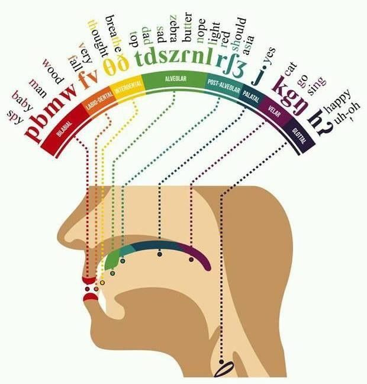
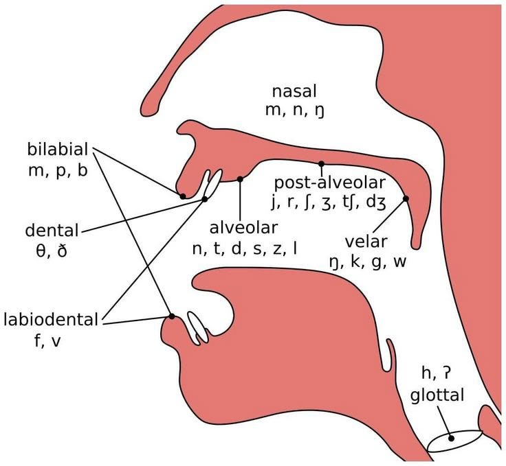
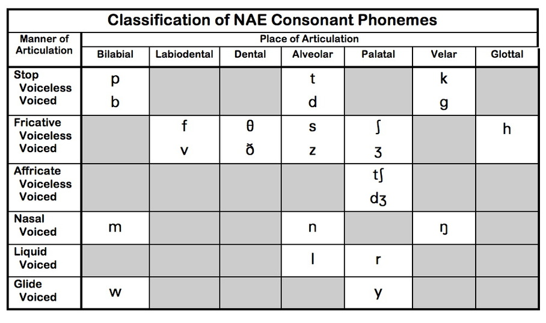
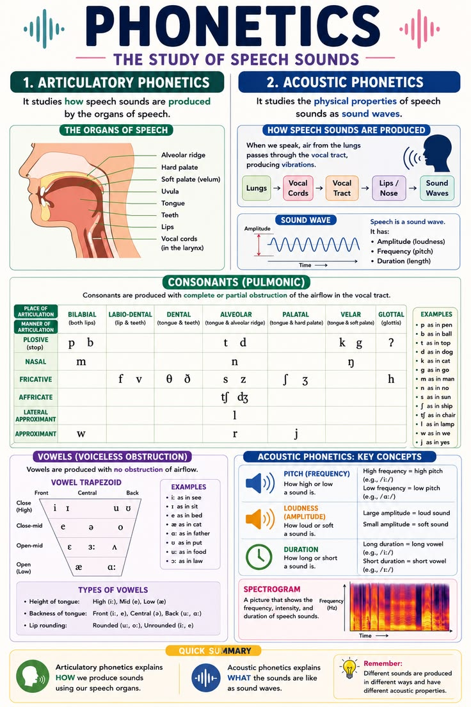

# 자음 음소 · B/P, D/T, G/K, V/F, S/Z, J/CH

2026-10-14 · 미국식 영어 중심. 목표는 같은 위치에서 만드는 자음을 구별하고, 단어와 문장에서 자연스럽게 말하는 것입니다.

## 자료와 사용 방법

첨부된 7장 중 B/P, D/T, G/K 강의 슬라이드 3장의 단어와 Accent O/X를 아래에 전사했습니다. 나머지 4장은 자음 분류표, 조음 위치 그림 2장, PHONETICS 개요입니다. 원본 이미지의 표기를 검토하고 필요한 보완 설명을 덧붙였습니다. 강의의 전체 설명이나 영상 주소는 제공되지 않았으므로 O/X의 의도를 확정하지 않습니다.

- **슬라이드 전사**: 이미지에 실제로 적힌 단어와 O/X 구분.
- **보완 설명**: 일반적인 음성학과 북미 영어 발음 경향.
- **추가 연습**: 이 자료에서 만든 최소대립쌍과 문장. 이미지의 예문으로 오해하지 않습니다.

굵은 영어 단어·문장은 기존 사이트의 기기 음성 기능으로 들을 수 있습니다. 기기 음성은 강사의 원음과 다르며, 기식·미방출·탄설음 확인에는 실제 화자의 녹음도 함께 사용하세요.

> **이미지 사용 및 공개 전 확인**: 원본 첨부 중 3~6번 도표만 수록하고, 1·2·7번 강의 화면 사진은 제외했습니다. 아래 네 이미지는 출처와 원저작자, 이용 조건이 확인되지 않은 외부 도표입니다. 공개 GitHub 저장소 또는 GitHub Pages에 배포하기 전에 저작권·재사용 허가와 출처 표기 조건을 확인해야 합니다. 현재 수록은 재사용 허가가 확인되었다는 의미가 아닙니다.

## 1. 소리를 설명하는 세 가지 기준

- **조음 위치 (place)**: 입술, 치경, 연구개 등 어디에서 공기를 막거나 좁히는가?
- **조음 방법 (manner)**: 완전히 막는 파열음, 좁은 틈을 통과하는 마찰음, 코로 공기를 보내는 비음 등 어떻게 만드는가?
- **성대 진동 (voicing)**: 성대가 진동하는가? /b d ɡ/는 유성, /p t k/는 무성 파열음입니다.

음소는 의미를 구별하는 소리 단위입니다. /p/와 /b/는 **pin / bin**처럼 단어를 구별합니다. `/ /`는 음소, `[ ]`는 실제 발음입니다. /t/가 [tʰ], [ɾ], [t̚] 등으로 달라져도 같은 음소의 변이일 수 있습니다.

### 기식과 성대 진동 시작 시점

입안의 폐쇄를 풀고 모음의 성대 진동이 시작될 때까지의 시간은 **VOT (voice onset time)**입니다. 영어 /p t k/는 강세 음절의 첫머리에서 대체로 기식이 강합니다. /b d ɡ/는 그 지연이 짧으며, 특히 단어 첫머리에서는 폐쇄 내내 성대가 진동하지 않을 수도 있습니다. 따라서 “B는 항상 목이 떨리고 P는 항상 공기가 세다”만으로 구별하면 부족합니다. [기식과 VOT 참고](https://ecampusontario.pressbooks.pub/essentialsoflinguistics/chapter/3-5-aspirated-stops-in-english/)

목에 손을 가볍게 대는 방법은 /z/와 /s/처럼 길게 낼 수 있는 소리에서 이해하기 쉽습니다. 파열음을 확인하려고 목을 조이거나 뒤에 불필요한 모음을 붙이지 마세요.

### 위치에 따른 공통 경향

- **강세 음절 첫머리**: pie, tea, key의 /p t k/는 [pʰ tʰ kʰ]처럼 기식이 뚜렷합니다.
- **같은 음절의 /s/ 뒤**: spy, stay, ski에서는 기식이 크게 줄어듭니다. 이것이 /b d ɡ/로 바뀐다는 뜻은 아닙니다.
- **비강세 음절 첫머리**: perform, today, together의 첫 자음은 기식이 상대적으로 약할 수 있지만, 무조건 기식이 없어지는 것은 아닙니다.
- **단어·음절 끝**: cap, cat, back은 입안의 폐쇄를 만들고 밖으로 크게 터뜨리지 않는 미방출 [p̚ t̚ k̚]이 가능합니다. 천천히 또렷하게 읽으면 방출되기도 합니다.
- **자음 앞**: help, desk처럼 끝 자음군에서 모든 자음을 세게 터뜨리려 하지 않습니다.
- **어말 유성음 앞의 모음**: cab/cap, bad/bat, bag/back에서 유성 자음 앞 모음은 대체로 더 깁니다. 어말 /b d ɡ/의 진동이 약해져도 모음 길이와 폐쇄 등 여러 단서로 구별합니다.

이것은 북미 영어의 일반적 경향이며 속도·강조·화자·방언에 따라 달라집니다.

## 2. Accent O/X를 읽을 때

**Accent O/X는 표준 음성학 범주가 아닙니다.** 여기서는 강의 슬라이드의 연습용 표기로만 유지합니다. O를 “항상 강하게”, X를 “무조건 무성·무기식·무강세”로 외우지 마세요. 단어 전체의 강세와 연습 대상 자음의 위치는 서로 다릅니다.

- **tap**은 P의 X에 있지만 단음절 단어로 강세를 받을 수 있습니다. /p/는 끝소리이므로 강세 음절 첫머리의 기식 규칙과 다릅니다.
- **absence**는 B의 O에 있지만 /b/는 첫 음절 끝에서 /s/ 앞에 있습니다. O가 모두 단어 첫 자음이라는 해석은 맞지 않습니다.
- **betray, because, perform**은 첫 음절에 주강세가 없지만 뒤 음절에는 주강세가 있습니다.
- **dog**의 /ɡ/는 끝소리이고, **go**의 /ɡ/는 첫소리입니다. 둘 다 G의 O입니다.
- **google**은 첫 /ɡ/와 가운데 /ɡ/가 있습니다. X가 어느 소리를 가리키는지 강의 설명 없이 단정할 수 없습니다.
- **fantastic, tent, turtle**도 /t/가 여러 번 나옵니다. 자음 하나씩 위치를 확인해야 합니다.

## 3. B / P · 두 입술로 만드는 파열음

### 발음 원리와 연습

/b/와 /p/는 **양순 파열음 (bilabial stops)**입니다. 두 입술을 닫아 공기를 막고 엽니다. /b/는 유성 계열, /p/는 무성 계열입니다. 혀를 입천장에 붙여 막는 소리가 아닙니다.

1. 입술을 가볍게 닫고 **buy / pie**를 번갈아 말합니다.
2. 입 앞에 얇은 종이를 두고 pie 첫머리의 기식을 관찰합니다. buy에서는 대체로 더 약합니다.
3. **pie / spy**를 비교합니다. spy의 /p/에는 같은 크기의 기식을 억지로 넣지 않습니다.
4. **cab / cap**을 비교하며 끝에 “으”를 붙이지 않습니다.

### 슬라이드 전사 · 모든 단어

- **B · Accent O**: **bus**, **ball**, **bubbles**, **absence**
- **B · Accent X**: **betray**, **because**, **habit**, **pebble**
- **P · Accent O**: **pig**, **pack**, **people**, **pan**
- **P · Accent X**: **staple**, **tap**, **help**, **perform**

bubbles, pebble의 첫 b와 뒤 b를 따로 비교하세요. habit의 /b/는 단어 가운데, staple의 /p/도 가운데에 있습니다. staple의 /p/는 첫 /st/와 떨어져 있으므로 “/s/ 바로 뒤의 /p/” 사례가 아닙니다. people의 첫 /p/와 뒤 /p/도 같은 정도의 기식이라고 가정하지 않습니다.

### 추가 최소대립쌍

- **bat / pat** — 방망이·박쥐 / 가볍게 두드리다
- **buy / pie** — 사다 / 파이
- **bear / pear** — 곰 / 배
- **big / pig** — 큰 / 돼지
- **bin / pin** — 통 / 핀
- **cab / cap** — 택시 / 모자

### 추가 문장 연습

- **Bob bought a big bag.** — 밥은 큰 가방을 샀어요.
- **The baby is blowing bubbles.** — 아기가 비눗방울을 불고 있어요.
- **Please put the pan on the table.** — 팬을 식탁 위에 놓아 주세요.
- **I put a cap in my bag.** — 가방에 모자를 넣었어요.

입술 폐쇄 → 단어 대비 → 문장 순서로 각각 3번 말합니다. 문장에서는 모든 P를 동일하게 세게 발음하지 않습니다.

## 4. D / T · 윗잇몸에서 만드는 파열음

### 발음 원리와 연습

/d/와 /t/는 **치경 파열음 (alveolar stops)**입니다. 혀끝 또는 혀날을 윗니 바로 뒤의 치경에 대어 막고 뗍니다. /d/는 유성 계열, /t/는 무성 계열입니다. /θ ð/처럼 혀를 앞니 사이에 내미는 소리와 구별합니다.

1. **day / tay**처럼 임의 음절을 사용하기보다 실제 단어 **die / tie**로 대비합니다.
2. **tea / stay**에서 /t/의 기식 차이를 비교합니다.
3. **bad / bat**을 말하며 모음 길이와 끝 폐쇄를 함께 듣습니다.

### 슬라이드 전사 · 모든 단어

- **D · Accent O**: **dad**, **day**, **definitely**, **today**
- **D · Accent X**: **discuss**, **needle**, **huddle**
- **T · Accent O**: **time**, **turtle**, **fantastic**, **tent**
- **T · Accent X**: **today**, **little**, **eating**, **together**

today는 D의 O와 T의 X 양쪽에 있습니다. 주강세는 뒤 음절이며 /d/는 그 음절의 첫머리, /t/는 앞 비강세 음절의 첫머리입니다. discuss도 뒤 음절에 주강세가 있습니다. fantastic의 강세 음절 첫 /t/와 뒤 /t/를 따로 보세요.

### 미국식 영어의 /t d/ 변이

- **탄설음 (flap/tap) [ɾ]**: 모음 사이에서 뒤 음절이 비강세일 때 /t d/가 혀로 치경을 짧게 한 번 치는 소리로 나타나는 경우가 많습니다. eating의 /t/, huddle의 /d/가 예입니다. 한국어 ㄹ과 비슷하게 들릴 수 있지만 같다고 외우지 않습니다.
- **little, turtle**: /t/ 뒤에 음절을 이루는 /l/이 오는 환경입니다. 탄설음이나 성문음화 등 화자별 변이가 있어 한 가지 소리만 정답으로 고정하지 않습니다.
- **needle**: /d/를 /l/로 이어 방출하거나 짧게 약화할 수 있습니다. /d/와 /l/ 사이에 불필요한 “으”를 넣지 않습니다.
- **어말 /t/**: cat의 끝에서 [t̚], 성문음화된 발음, 방출된 [t] 등이 가능합니다. 모든 T가 [ɾ]가 되는 것은 아닙니다.
- **단어 경계**: get it에서도 조건에 따라 탄설음이 나올 수 있습니다. 먼저 천천히 정확하게 읽고 자연스러운 원음을 따라 합니다.

### 추가 최소대립쌍

- **die / tie** — 죽다 / 넥타이·묶다
- **do / two** — 하다 / 둘
- **den / ten** — 굴 / 열
- **dough / toe** — 반죽 / 발가락
- **bad / bat** — 나쁜 / 방망이·박쥐
- **seed / seat** — 씨앗 / 좌석

### 추가 문장 연습

- **Dad did the dishes today.** — 아빠가 오늘 설거지를 했어요.
- **Take your time.** — 천천히 하세요.
- **We are eating together.** — 우리는 함께 먹고 있어요.
- **The little turtle is in the tent.** — 작은 거북이가 텐트 안에 있어요.

마지막 두 문장은 천천히 읽기와 자연스럽게 이어 읽기를 각각 녹음해 비교합니다.

## 5. G / K · 혀 뒤쪽에서 만드는 파열음

### 발음 원리와 연습

/ɡ/와 /k/는 **연구개 파열음 (velar stops)**입니다. 혀 뒤쪽을 연구개에 붙여 막고 뗍니다. /ɡ/는 유성 계열, /k/는 무성 계열입니다. 목을 조이거나 혀끝을 윗잇몸에 붙이지 않습니다.

1. **go / coat**는 최소대립쌍이 아니므로 위치 감각 연습에만 사용합니다. 소리 대비에는 **goat / coat**를 씁니다.
2. **key / ski**로 기식 차이를 관찰합니다.
3. **bag / back**에서 모음 길이와 끝 폐쇄를 비교합니다.

### 슬라이드 전사 · 모든 단어

- **G · Accent O**: **go**, **dog**, **garbage**, **together**
- **G · Accent X**: **wiggle**, **google**, **burger**, **igloo**
- **K · Accent O**: **cop**, **location**, **character**, **queen**, **occur**
- **K · Accent X**: **desk**, **box**, **cackle**

원본의 대소문자는 학습 편의를 위해 통일했습니다. G의 X에 적힌 “Burger igloo”는 burger와 igloo 두 단어로 읽었습니다.

철자와 음소를 구별하세요. queen의 qu는 /kw/, box의 x는 /ks/, character의 ch는 /k/입니다. garbage의 첫 g는 /ɡ/지만 마지막 ge는 /dʒ/입니다. cackle은 /k/가 두 번 나옵니다. location과 occur에서는 주강세 음절 첫머리에 /k/가 옵니다. dog의 /ɡ/와 desk·box의 /k/는 끝 또는 끝 자음군에서 관찰하세요.

### 추가 최소대립쌍

- **goat / coat** — 염소 / 외투
- **gap / cap** — 틈 / 모자
- **gate / Kate** — 문 / 사람 이름 케이트
- **glue / clue** — 접착제 / 단서
- **bag / back** — 가방 / 등·뒤
- **pig / pick** — 돼지 / 고르다

### 추가 문장 연습

- **Go get your green bag.** — 가서 초록색 가방을 가져오세요.
- **The dog is in the garden.** — 개가 정원에 있어요.
- **Kate keeps the keys in her coat.** — 케이트는 외투에 열쇠를 넣어 둬요.
- **Put the box on the desk.** — 상자를 책상 위에 놓으세요.

## 6. V / F · 윗니와 아랫입술로 만드는 마찰음

추가로 첨부한 V/F 강의 화면의 인쇄된 단어와 Accent O/X를 전사했습니다. 손글씨는 뜻이 분명하지 않아 전사하지 않았으며, 화면 사진은 수록하지 않습니다. 아래 발음 설명·최소대립쌍·문장은 별도로 보완한 학습 자료입니다.

### 발음 원리와 연습

/v/와 /f/는 **순치 마찰음 (labiodental fricatives)**입니다. 윗니를 아랫입술 안쪽에 가볍게 대고, 좁은 틈으로 공기를 계속 흘립니다. /v/는 유성, /f/는 무성 계열입니다. B/P처럼 두 입술을 완전히 닫았다가 터뜨리는 소리와 구별하세요.

1. 윗니를 아랫입술에 가볍게 대고 **/f/**를 1~2초 냅니다. 입술을 세게 깨물지 않습니다.
2. 같은 위치에서 성대 진동을 더해 **/v/**를 냅니다. 목에 손을 가볍게 대고 /f/와 번갈아 비교합니다. 실제 단어에서는 /v/의 진동이 부분적으로 약할 수도 있습니다.
3. **van / fan**을 말합니다. /v/ 뒤에 불필요한 “으”를 넣지 않습니다.
4. **ban / van**을 비교합니다. ban은 두 입술을 닫는 /b/, van은 윗니·아랫입술 사이로 공기를 흘리는 /v/입니다.
5. **leave / leaf**를 비교합니다. 끝소리를 생략하거나 “브·프”처럼 별도 음절로 만들지 않습니다. leave의 앞 모음은 leaf보다 대체로 더 깁니다.

### 슬라이드 전사 · 모든 단어

- **V · Accent O**: **van** — 승합차, **victory** — 승리, **invite** — 초대하다, **very** — 매우
- **V · Accent X**: **seven** — 일곱, **travel** — 여행하다, **believe** — 믿다, **leave** — 떠나다·남기다
- **F · Accent O**: **fan** — 선풍기·팬, **finish** — 끝내다, **family** — 가족, **far** — 멀리
- **F · Accent X**: **off** — 떨어져·꺼진, **forgive** — 용서하다, **flavor** — 맛·풍미, **leaf** — 잎

원본의 Seven, Off는 다른 단어와 맞춰 소문자로 적었습니다. forgive는 F 연습 단어이지만 끝에는 /v/도 있으므로 두 소리를 따로 확인하세요.

### Accent O/X와 실제 소리 위치

O/X는 강의의 연습용 표기이며, “강세 있음/없음” 또는 “유성/무성”으로 바꾸어 해석하지 않습니다. X에 있는 V도 /v/, F도 /f/입니다.

- **invite**는 뒤 음절에 주강세가 있고 /v/가 그 음절의 첫머리에 있습니다. van, victory, very의 /v/는 단어 첫머리입니다.
- **seven, travel**의 /v/는 단어 가운데에, **believe, leave**의 /v/는 끝에 있습니다. believe는 뒤 음절에 주강세가 있으므로 X가 “단어에 강세가 없다”는 뜻은 아닙니다.
- **off, leaf**의 /f/는 끝소리입니다. off는 문맥에 따라 강세를 받을 수 있습니다.
- **forgive**의 /f/는 주강세 앞 음절에 있습니다. **flavor**는 첫 음절에 주강세가 있고 /fl/ 자음군으로 시작합니다. 따라서 X를 모두 “비강세”라고 설명할 수 없습니다.
- 파열음 /p t k/에서 다룬 기식 규칙을 V/F에 그대로 적용하지 않습니다. V/F에서는 지속되는 마찰과 성대 진동, 단어 안의 위치를 중심으로 관찰합니다.

### 추가 최소대립쌍

- **van / fan** — 승합차 / 선풍기·팬
- **vine / fine** — 덩굴 / 좋은·괜찮은
- **vat / fat** — 큰 통 / 지방
- **save / safe** — 구하다·저장하다 / 안전한
- **leave / leaf** — 떠나다 / 잎
- **live / life** — 살다 / 삶. 여기서 live는 동사 /lɪv/이며, “생방송의”라는 뜻의 /laɪv/와 구별합니다.

### 추가 문장 연습

- **The van has a fan.** — 그 승합차에는 선풍기가 있어요.
- **Five friends visited the village.** — 친구 다섯 명이 그 마을을 방문했어요.
- **Please turn off the fan.** — 선풍기를 꺼 주세요.
- **I believe we can finish it.** — 우리가 그것을 끝낼 수 있다고 믿어요.
- **Please leave the leaf on the table.** — 그 잎을 탁자 위에 놓아 주세요.

### V/F 3분 복습

1. **30초**: /f/와 /v/를 길게 번갈아 내며 윗니·아랫입술과 목의 진동 확인.
2. **1분**: van/fan, save/safe, leave/leaf를 각각 3번. 가능하면 상대가 들은 단어를 맞히게 하기.
3. **1분**: 슬라이드 O/X 단어를 천천히 읽고, 대상 자음이 처음·중간·끝 어디에 있는지 확인.
4. **30초**: 문장 하나를 녹음하고 /v/가 /b/로 바뀌거나 끝에 모음을 덧붙이지 않았는지 확인.

## 7. S / Z · 혀 앞쪽으로 만드는 마찰음

첨부한 S/Z 화면의 인쇄된 단어와 O/X를 전사했습니다. 손글씨와 강의 화면 사진은 수록하지 않습니다. 발음 설명과 추가 연습은 별도로 보완한 내용입니다.

### 발음 원리와 연습

/s/와 /z/는 **치경 마찰음**입니다. 혀 앞쪽을 치경 가까이 두고 좁은 틈으로 공기를 계속 흘립니다. 혀로 공기를 완전히 막거나 앞니 사이로 내밀지 않습니다. /s/는 무성, /z/는 유성 계열입니다.

1. **/s/**를 1~2초 길게 냅니다. /ʃ/처럼 “쉬” 소리가 되지 않도록 비교합니다.
2. 같은 위치에서 성대 진동을 더해 **/z/**를 냅니다. 목에 손을 가볍게 대고 비교하되 목을 조이지 않습니다.
3. **sip / zip**, **bus / buzz**를 번갈아 말합니다. /z/를 “즈”라는 별도 음절로 만들지 않습니다.
4. 끝의 /z/는 진동이 부분적으로 약해질 수 있습니다. 앞 모음 길이도 함께 들으세요. buzz의 모음은 bus보다 대체로 더 깁니다.

### 슬라이드 전사 · 모든 단어

- **S · Accent O**: **spend** — 쓰다·소비하다, **sun** — 태양, **seven** — 일곱, **science** — 과학
- **S · Accent X**: **miss** — 놓치다·그리워하다, **mouse** — 쥐, **fascinate** — 매료하다, **dancing** — 춤추기
- **Z · Accent O**: **zoo** — 동물원, **zip** — 지퍼를 잠그다, **zebra** — 얼룩말, **disaster** — 재난
- **Z · Accent X**: **please** — 부탁할 때 쓰는 말·기쁘게 하다, **size** — 크기, **busy** — 바쁜, **lives** — 살다의 3인칭 단수·life의 복수

원본의 Spend, Miss, Please는 소문자로 통일했습니다. lives는 “살다”의 동사형 /lɪvz/와 life의 복수 /laɪvz/ 모두 끝소리가 /z/입니다.

### Accent O/X와 철자 주의

- **science**는 첫소리와 끝소리에 /s/가 있습니다. 어느 소리를 O로 연습하는지는 강의 설명 없이 단정하지 않습니다.
- **disaster**는 가운데 /z/가 강세 음절의 첫머리입니다. 철자 s도 /z/로 발음할 수 있습니다.
- **busy**의 s는 /z/, **please, size**의 끝소리도 /z/입니다. 철자와 음소를 구별하세요.
- **miss, mouse**는 강세를 받을 수 있는 단음절 단어이고, **fascinate, dancing**도 단어 안에 강세가 있습니다. X가 “강세 없음”이라는 뜻은 아닙니다.
- **spend**의 /s/는 마찰음입니다. 뒤 /p/의 기식이 줄어드는 현상과 /s/ 자체를 구별합니다.

### 추가 최소대립쌍과 문장

- **sip / zip** — 조금씩 마시다 / 지퍼를 잠그다
- **seal / zeal** — 물개·봉인 / 열의
- **bus / buzz** — 버스 / 윙윙거리는 소리
- **Sue sees a zebra.** — 수는 얼룩말을 봐요.
- **Please zip the bag.** — 가방 지퍼를 잠가 주세요.
- **The busy zoo opens at seven.** — 그 붐비는 동물원은 7시에 문을 열어요.

**1분 점검:** /s z/ 길게 내기 → sip/zip 세 번 → 문장 하나 녹음. /z/가 /dʒ/로 바뀌거나 불필요한 모음이 붙지 않았는지 확인합니다.

## 8. J / CH · 막았다가 마찰로 이어지는 파찰음

첨부한 J/CH 화면의 인쇄된 단어와 O/X를 전사했습니다. 여기서 J는 **/dʒ/**이며, yes의 첫소리 /j/와 다릅니다. 강의 화면 사진은 수록하지 않습니다.

### 발음 원리와 연습

/dʒ/와 /tʃ/는 **후치경 파찰음**입니다. 혀끝·혀날로 치경 뒤쪽 부근에서 공기를 막았다가 마찰로 이어 풉니다. /dʒ/는 유성, /tʃ/는 무성 계열입니다. 폐쇄와 마찰을 서로 떨어진 두 음절로 만들지 않습니다.

1. **jeep / cheap**을 천천히 번갈아 말하며 막았다가 풀리는 느낌을 비교합니다.
2. **gin / chin**으로 같은 모음 앞의 자음 차이를 듣습니다.
3. **ridge / rich**의 끝소리를 비교하고 “지·치”처럼 모음을 덧붙이지 않습니다. ridge의 앞 모음은 대체로 더 깁니다.
4. /s z/는 마찰을 이어갈 수 있지만 /tʃ dʒ/는 처음에 폐쇄가 있습니다. **zip / jeep**도 비교하되, 두 단어는 모음도 달라 최소대립쌍은 아닙니다.

### 슬라이드 전사 · 모든 단어

- **J · Accent O**: **jelly** — 젤리, **gentle** — 온화한·부드러운, **pajama** — 잠옷과 관련된 형태, **jump** — 뛰다
- **J · Accent X**: **imagine** — 상상하다, **message** — 메시지, **budget** — 예산
- **CH · Accent O**: **cheese** — 치즈, **chest** — 가슴·상자, **change** — 바꾸다·변화, **church** — 교회
- **CH · Accent X**: **question** — 질문, **future** — 미래, **watch** — 보다·손목시계, **ditch** — 도랑

원본의 Jelly, Imagine는 소문자로 통일했습니다. **pajama**는 원문 표기입니다. 미국 영어에서 잠옷을 가리킬 때는 보통 복수형 **pajamas**를 쓰며, pajama는 pajama party처럼 명사 앞에서 쓰이기도 합니다.

### Accent O/X와 철자 주의

- **gentle, imagine, message, budget**의 g·ge·dg도 /dʒ/를 나타냅니다. J라는 글자가 있어야만 /dʒ/가 되는 것은 아닙니다.
- **pajama**와 **imagine**은 가운데 /dʒ/가 강세 음절의 첫머리에 있지만 O/X가 다릅니다. O/X를 단순한 강세 규칙으로 해석하지 않습니다.
- **change**는 첫소리 /tʃ/와 끝소리 /dʒ/를 모두 연습할 수 있습니다. **church**는 처음과 끝에 /tʃ/가 있습니다.
- **question, future**의 /tʃ/는 ch 철자가 없는 사례입니다. **watch, ditch**의 tch는 /tʃ/라는 하나의 음소를 나타냅니다.
- **watch, ditch**는 X에 있어도 강세를 받을 수 있습니다. 끝소리의 위치와 단어 강세를 구별하세요.
- ch가 항상 /tʃ/인 것은 아닙니다. 앞서 연습한 **character**의 ch는 /k/입니다.

### 추가 최소대립쌍과 문장

- **jeep / cheap** — 지프차 / 저렴한
- **gin / chin** — 진(술) / 턱
- **ridge / rich** — 산등성이 / 부유한
- **Jane chose a cheap jacket.** — 제인은 저렴한 재킷을 골랐어요.
- **Please check the message.** — 메시지를 확인해 주세요.
- **We can change the budget.** — 우리는 예산을 바꿀 수 있어요.

**1분 점검:** jeep/cheap, ridge/rich를 세 번 → change의 처음·끝 비교 → 문장 하나 녹음. 폐쇄 뒤 마찰이 이어지는지, 끝에 모음을 덧붙이지 않는지 확인합니다.

## 9. 발음 기관 · 나머지 이미지 읽기

### 원본 4번 · 조음 위치 그림

### 원본 5번 · 구강 단면도

그림의 단순화된 분류는 아래의 보완 설명과 함께 읽으세요.

공기는 폐에서 올라와 후두와 성도를 통과합니다. 유성음에서는 성대가 진동하고, 혀·입술·턱 등이 소리의 모양을 바꿉니다. 무성음은 성대 진동 없이도 공기 흐름과 마찰·파열로 만들어집니다.

- **Lungs · 폐**: 말을 위한 공기 공급.
- **Larynx / vocal folds · 후두 / 성대**: 발성과 성대 진동. 그림의 vocal cords와 같은 기관을 가리킵니다.
- **Glottis · 성문**: 성대 사이의 공간. /h/와 [ʔ]을 이해하는 위치입니다.
- **Lips / teeth · 입술 / 치아**: /p b m/과 /f v θ ð/ 연습에 사용.
- **Alveolar ridge · 치경**: 윗니 뒤의 도톰한 부분. /t d n s z l/의 기준 위치.
- **Hard palate · 경구개**: 단단한 입천장. /j/처럼 혀 앞쪽을 가까이 하는 소리.
- **Soft palate / velum · 연구개**: 입천장 뒤의 부드러운 부분. /k ɡ ŋ/의 위치이며, 코로 가는 공기 흐름도 조절.
- **Uvula · 목젖**: 연구개 뒤 끝에 매달린 부분. 영어 /ɡ k/를 목젖 소리로 연습하지 않습니다.
- **Tongue · 혀**: 혀끝·혀날·앞부분·뒤쪽이 서로 다른 역할을 합니다.
- **Oral / nasal cavity · 구강 / 비강**: 공명이 생기는 공간. /m n ŋ/에서는 코로 공기가 흐릅니다.

기관별 개념은 [Speech articulators](https://ecampusontario.pressbooks.pub/essentialsoflinguistics2/chapter/3-2-speech-articulators/)와 대조해 학습하세요.

### 조음 위치 분류표 · 영어 자음 중심

아래는 첨부 분류표를 IPA에 맞춰 보완한 학습용 요약입니다. 각 쌍은 **무성 / 유성** 순서입니다.

| 위치 | 사용하는 부분 | 파열음 | 마찰음 | 파찰음 | 비음·접근음 |
| --- | --- | --- | --- | --- | --- |
| 양순 bilabial | 두 입술 | /p b/ | — | — | /m/ |
| 순치 labiodental | 아랫입술·윗니 | — | /f v/ | — | — |
| 치 dental | 혀·앞니 | — | /θ ð/ | — | — |
| 치경 alveolar | 혀끝·혀날·치경 | /t d/ | /s z/ | — | /n l/ |
| 후치경 postalveolar | 치경 바로 뒤 | — | /ʃ ʒ/ | /tʃ dʒ/ | /ɹ/는 화자별 조음 차이 있음 |
| 경구개 palatal | 혀 앞쪽·경구개 | — | — | — | /j/ |
| 연구개 velar | 혀 뒤쪽·연구개 | /k ɡ/ | — | — | /ŋ/ |
| 성문 glottal | 성문 | [ʔ] 변이 | /h/ | — | — |
| 양순·연구개 labial-velar | 입술 둥글림·혀 뒤쪽 | — | — | — | /w/ |

- **파열음 stop/plosive**: 공기를 완전히 막았다가 풉니다. 미방출이면 밖으로 뚜렷한 파열이 들리지 않을 수 있습니다.
- **마찰음 fricative**: 좁은 틈으로 공기를 보내 마찰을 만듭니다.
- **파찰음 affricate**: 폐쇄 뒤 마찰로 이어지는 하나의 자음. /tʃ dʒ/입니다.
- **비음 nasal**: 입안에 폐쇄가 있고 코로 공기를 보냅니다. /m n ŋ/.
- **접근음 approximant**: 마찰이 강하게 생기지 않을 정도로 접근합니다. /ɹ j w/와 측면 접근음 /l/.

### 이미지 분류와 표기에서 보완할 점

1. 분류표의 NAE는 North American English, 북미 영어를 뜻합니다. 모든 언어의 자음 목록은 아닙니다.
2. 표의 “Palatal”은 /ʃ ʒ tʃ dʒ/까지 묶은 넓은 수업용 분류입니다. 여기서는 후치경과 경구개를 구별합니다.
3. yes의 첫소리는 IPA **/j/**입니다. 표의 y는 일반 철자식 표기입니다. 영어 알파벳 J의 대표 소리 /dʒ/와 다릅니다.
4. 일부 그림은 /j/를 후치경에 넣지만, 표준 분류에서는 경구개 접근음입니다.
5. /w/를 양순 또는 연구개 한쪽에만 배치한 그림은 단순화입니다. 입술과 혀 뒤쪽을 함께 사용합니다.
6. 영어 r은 보통 /ɹ/로 적으며 말린 혀나 뭉친 혀 등 여러 조음이 가능합니다. IPA /r/의 전동음과 구별합니다.
7. sing 끝소리는 **/ŋ/**입니다. 보통 뒤에 /ɡ/를 덧붙이지 않습니다. 그림에서 n처럼 보이는 기호와 구별하세요.
8. [ʔ]은 성문 파열음입니다. 일반적인 북미 영어에서는 /t/ 등의 변이로 다루며, 이 표에서 독립 영어 음소로 확정하지 않습니다.

정식 기호와 위치는 [국제음성학회 IPA 차트](https://www.internationalphoneticassociation.org/content/ipa-chart), 영어 설명은 [Place and phonation](https://ecampusontario.pressbooks.pub/essentialsoflinguistics2/chapter/3-3-describing-consonants-place-and-phonation/)을 참고합니다.

## 10. 조음음성학과 음향음성학

도표의 일부 제목·기호는 부정확하므로 아래 보완 설명을 함께 확인하세요.

**조음음성학 (articulatory phonetics)**은 발음 기관을 어떻게 움직여 소리를 만드는지 연구합니다. 예: /p/에서 두 입술을 닫는가? /k/에서 혀 뒤쪽을 연구개에 대는가?

**음향음성학 (acoustic phonetics)**은 만들어진 소리의 물리적 특성을 연구합니다. 녹음에서 파열 시점, 기식 구간, 성대 진동 시작, 모음 길이 등을 관찰할 수 있습니다.

- **파형 waveform**: 시간에 따른 진폭 변화. 음이 언제 시작하고 얼마나 지속되는지 살펴봅니다.
- **주파수 frequency**: 진동 속도. 유성음의 기본주파수 F0는 지각되는 높낮이와 관련되지만, 모든 주파수가 곧 pitch는 아닙니다.
- **진폭 amplitude / 강도 intensity**: 음량 지각과 관련되며, 실제 loudness는 주파수와 청각 조건에도 영향을 받습니다.
- **지속시간 duration**: 소리나 구간의 길이. 강세·말하기 속도·뒤 자음 등의 영향을 받습니다.
- **스펙트로그램 spectrogram**: 보통 가로축 시간, 세로축 주파수, 색·명암으로 에너지 분포를 표시합니다. 성도 공명에 따른 포먼트와 마찰 소음 등을 볼 수 있습니다.

PHONETICS 이미지의 “Vowels (voiceless obstruction)”은 부정확한 제목입니다. 모음은 대체로 성도의 큰 폐쇄나 마찰 없이 만들어지며 보통 유성입니다. 무성 모음이 나타나는 언어나 환경도 있으므로 “모음은 항상 유성”이라고 단정하지 않습니다. 또한 /iː/가 언제나 높은 pitch, /ɑː/가 언제나 낮은 pitch인 것은 아닙니다. 모음의 종류와 말소리의 높낮이를 구별하세요.

이미지의 모음 사다리꼴은 혀 높이·앞뒤 위치와 입술 둥글림을 이해하는 보조 자료입니다. /ɒ ɜː/ 등은 영국식 표기와 연결되는 경우가 있어 북미 영어의 모음 목록으로 그대로 외우지 않습니다. 소리 생성과 분류의 개요는 [Sonority, Consonants, and Vowels](https://pressbooks.pub/essentialsoflinguistics/chapter/2-6-producing-speech-sounds/)를 참고하세요.

### 다음 강의 기록 양식

- 학습일 / 강의 제목 / URL / 시간 구간:
- 이미지 번호 / 연습 대상 음소:
- 발음 원리 / 조음 위치 / 조음 방법:
- 유성·무성 / 실제 진동·기식의 단서:
- 슬라이드 Accent O 단어 / Accent X 단어:
- 주강세 위치 / 대상 자음의 위치 / 예외:
- 최소대립쌍 / 뜻 / 연습 문장:
- 내 녹음에서 고칠 점 한 가지 / 다음 복습일:

## 11. 하루 7분 복습

1. **1분**: 입술 → 치경 → 연구개 위치를 바꾸며 buy/pie, die/tie, goat/coat.
2. **2분**: 각 쌍에서 최소대립쌍 2개씩. 상대가 어떤 단어인지 맞혀 보게 합니다.
3. **1분**: pie/spy, tea/stay, key/ski의 기식을 비교합니다.
4. **1분**: cab/cap, bad/bat, bag/back의 끝소리와 앞 모음 길이를 비교합니다.
5. **1분**: van/fan, sip/zip, jeep/cheap을 번갈아 말하며 마찰음과 파찰음을 비교합니다.
6. **1분**: 문장 하나를 녹음하고 고칠 점 한 가지만 적습니다.

자가 점검: 소리 뒤에 “으”를 붙였는가? O/X를 절대 규칙으로 외웠는가? 철자와 IPA를 혼동했는가? 강세 음절 첫머리와 끝소리를 구별했는가?

[발음 노트](./pronunciation-notes.md) · [아침 5분 연습](./morning-practice.md) · [단어 추출 연습](./word-practice.md) · [주간 복습](../review/week-01.md)
